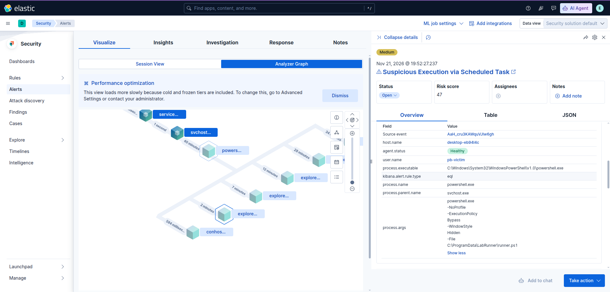
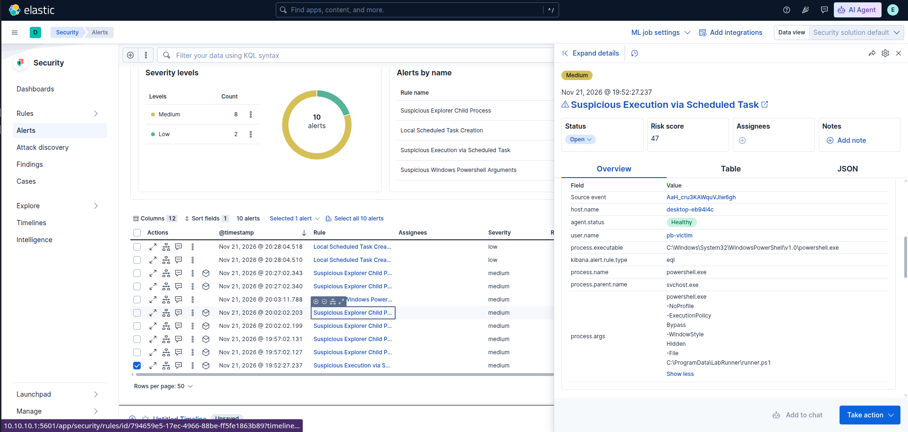
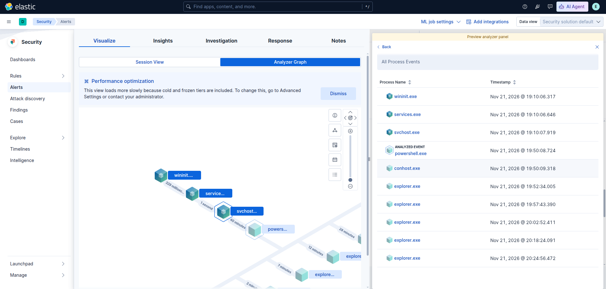
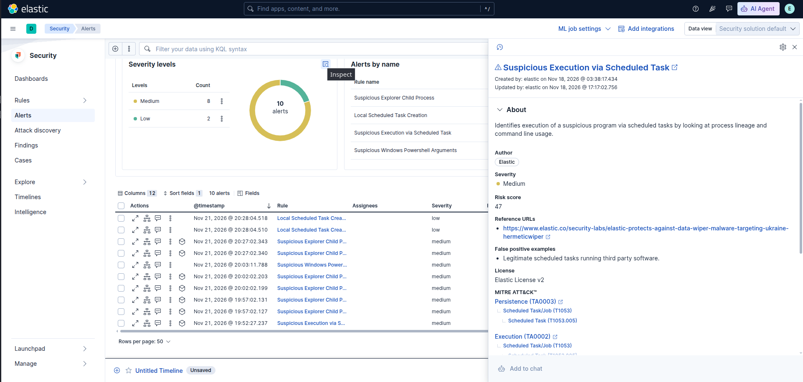

## Alert 1: Suspicious Execution via Scheduled Task
- **Alert Time:** 19:52:27.237
- **Event Time / host / user:** 19:50:09.720 / desktop-eb94l4c / pb-victim
- **Severity / risk score:** Medium / 47
- **What fired:** Suspicious Execution via Scheduled Task, by looking at the process lineage and command line usage
- **Process tree:** svchost.exe → powershell.exe (Analyzer)
- **What I checked:** (queries: host.name : "desktop-eb94l4c"; fields: process.command_line; process.args; process.name; process.parent.name; event.code; enrichment like VirusTotal/AbuseIPDB)

### Initial assessment (before hints)
- **Benign hypothesis:** what would make this harmless? Evidence for/against: A scheduled task is something that commonly happens, it would be harmless if the process command line were not ambiguous. The fact that the command line uses -ExecutionPolicy Bypass and -WindowStyle Hidden is suspicious enough and looks like no legitimate action. And the script which was executed, "runner.ps1", is not known.
- **Verdict:** TP · confidence 80 %
- **Reasoning:** I have looked at the process.command_line and looked into args to see if anything was ok, then looked into the file which was executed to see if it is known from our view. The correlation of both elements gives me reasons that this is not a legitimate action.
- **Follow-up / tuning idea:** Since the rule caught this event, I have no tuning idea for this event

### Revised assessment (after hint during triage)
- **Verdict:** Lab artifact (benign TP) – excluded · confidence 95 %
- **Why revised:** I had not checked the script path against the known lab artifacts (C:\ProgramData\LabRunner\ ). process.args, parent (svchost.exe) and start time (~19:50, see event time) exactly match the documented LabRunner task action (install.ps1). Bypass/Hidden alone triggered the rule; the activity is authorised.
- **Follow-up / tuning idea:** narrow exception for this exact command line + parent + path (post-debrief).

---

## Summary
| # | Alert | Verdict | Confidence |
|---|---|---|---|
|001|Suspicious Execution via Scheduled Task| True Positive (initial) → Lab artifact / benign TP (revised) | 80% → 95% |

## Evidence

