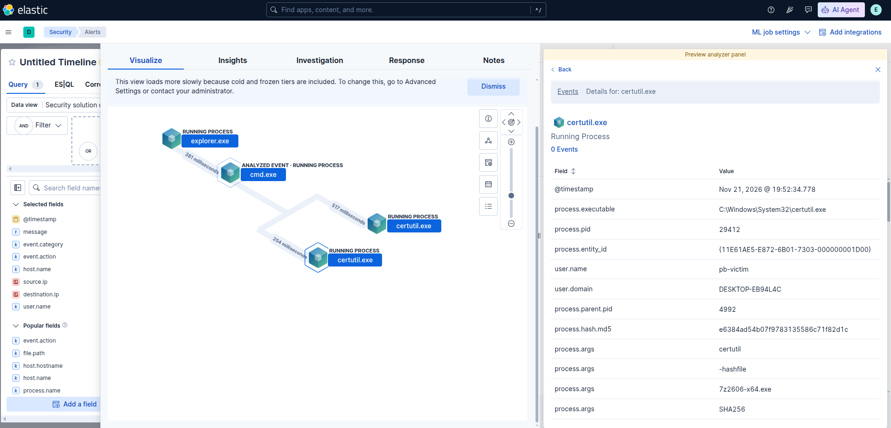
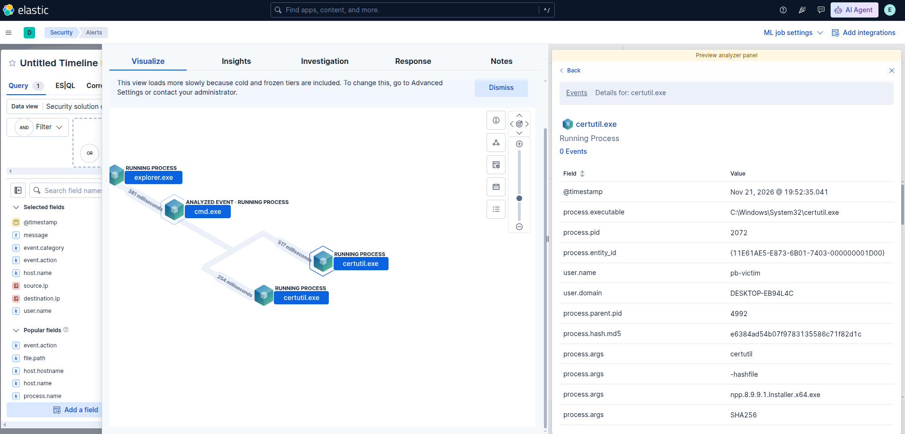
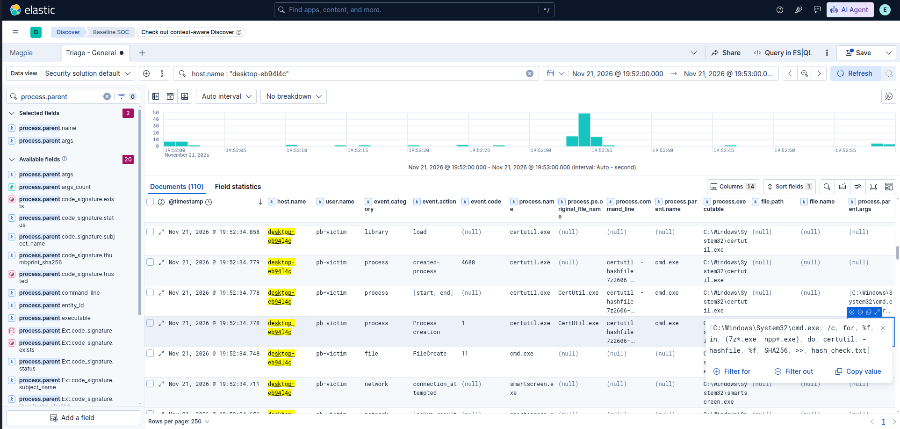
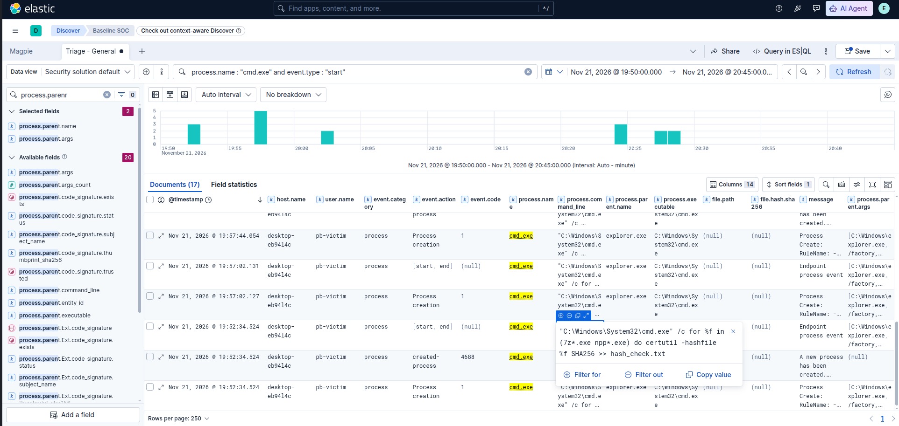
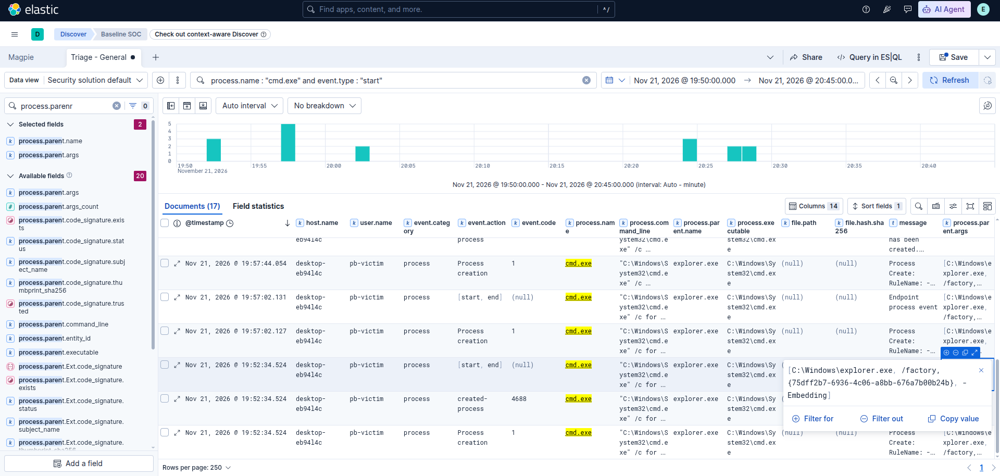

## Alert 2: Suspicious Explorer Child process
- **Alert time:** 19:57.02.127
- **Event time / host / user:** 19:52:02 /desktop-eb94l4c / pb-victim
- **Severity / risk score:** Medium / 47
- **What fired:** Identifies a suspicious Windows explorer child process. Explorer.exe can be abused to launch malicious scripts or executables from a trusted parent process
- **Process tree:** parent: explorer.exe; child:cmd.exe
- **What I checked:** (queries:host.name : "desktop-eb94l4c", fields: process.name; event.action; process.command_line; process.parent.name; winlog.task; file.path; file.name
- **Benign hypothesis:** what would make this harmless? Evidence for/against: the args -hashfile and the creation of the file hash_check.txt with the hash value inside.
- **Verdict:** benign-TP · confidence 75 %
- **Reasoning:** the arg -hashfile is harmless and there were no furhter encounter including the hash_check.txt file newly created with the hashes inside.
- **Follow-up / tuning idea:**

---

## Hunt (15 min)
| Query | What I looked for | Finding |
|---|---|---|

## Summary
| # | Alert | Verdict | Confidence |
|---|---|---|---|
|002|Suspicious Explorer Child Process|Benign True Positv| 75%|

## Evidence

