## Alert 6: Suspicious Windows powershell Arguments
- **Alerttime:** 20:03:11.788
- **Eventtime / host / user:**20:02:57.156 / desktop-eb94l4c / pb-victim
- **Severity / risk score:** Medium / 47
- **What fired:** Identifies the execution of PowerShell with suspicious argument values. This behavior is often observed during malware installation leveraging PowerShell
- **Process tree:** Delivery at the front: Rechnung_2026-11.pdf.lnk (Downloads, 20:02:50) -> parent: explorer.exe -> child: powershell.exe
- **What I checked:** (queries: host.name; process.name : "powershell.exe and event.category : ("file" or "registry" or "network"); fields: process.name, proces.command_line; process.parent.name; file.path, file.name (lnk/theme.dat);event.code : "1116" / "1117"; winlog.event_data.Threat_Name; winlog.event_data.Threat_ID, winlog.event_data.Action_Name and CyberChef as tool to decode the Base64 String
- **Benign hypothesis:** what would make this harmless?? Evidence for:Some legitimate software and admin scripts also use -enc/hidden/bypass (e.g. installers, management agents).
  Evidence against: disguised .lnk, a payload in AppData\…\Themes, an AV (windows Defender) detection.
- **Verdict:** true positive · confidence 90%
- **Reasoning:**The args used for the command line were suspicious enough (hidden, bypass, -enc, "Base64 String*") but there were not enough. At 20:02:57.714 a malware is detected by windows defender (event code 1116), looking into this event, we could see the exact same command used at 20:02:57.156 and with the field winlog.event_data.Threat_Name the malware had the name Trojan:Win32/ClickFix.ZB which is well known as a social-engineering lure. the Windows Defender removed the threat which was a command line in powershell process (event code 1117) at 20:04:13.552.
- **Chain (timeline):**
  - 20:02:46.571 theme.dat is created
  - 20:02:50.083 Delivery of rechnung 2026-11.pdf.lnk created in Downloads
  - 20:02:52.411 explorer.exe (pid 16208) with the .lnk path in process.args
  - 20:02:56.309 explorer.exe /factory, ... (pid 15424; COM handoff)
  - 20:02:57.156 powershell.exe -nop -w hidden -ep bypass -enc "Base 64 String" (pid 3696, parent pid 15424)
  - 20:02:57.714 Defender 1116: Trojan:Win32/clickFix.ZB
  - 20:03:11.788 Alert from Microsoft Windows Security Auditing (source event = 20:02:57.156, same pid 3696 / record id 53947)
  - 20:04:13.552 Defender 1117: action Remove (resource: CmdLine)
- **Follow-up / tuning idea:** This time only one sensor were able to spot the threat. Neither Sysmon nor Elastic Defend had a clear event about this. Normally each three sensors spotted something unusual at the same time but it was not the case this time. furthermore the remediation from Windows defender was against the process performing the command file, not against a file. So the containement may be incomplete if theme.dat (the file named created and discovered after deconder the base 64 string) were successfully was not removed from the system. Same scenario with rechnung 2026-11.pdf.lnk which may be still in the disk. the containment outcome of those 2 files is incertain.
  At last during the process of scope defintiion to see if theme.dat were somehow later executed, uploaded etc, we found another suspicious process command line, but this time there were no alert around that time but way later. this finding will be investigated on Threat Hunting.
  The Explorer child rule was blind to this Powershell, since only 4688 had it and and 4688 lacks process.parent.args, so no alert about suspicious explorer child process could be fired in this case. This is a blindspot and an useful information for rule tuning
  Microsoft Defender detected and removed the threat (event.code 1116 and 1117) but these events did not create an alert in the Kibana alert queue (no rule enabled for Defender events). Elastic Defend (EDR) produced neither an alert nor a process event for this PowerShell.

---

## Hunt (15 min)
| Query | What I looked for | Finding |
|---|---|---|

## Summary
| # | Alert | Verdict | Confidence |
|---|---|---|---|
|006|Suspicious Windows Powershell Arguments| True Positive|90%|

## Evidence

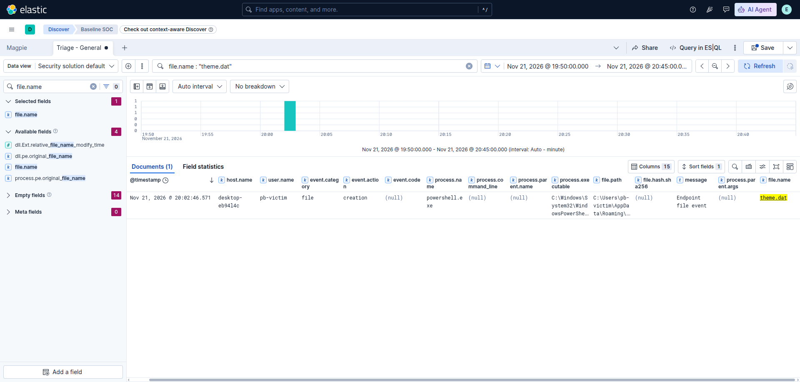

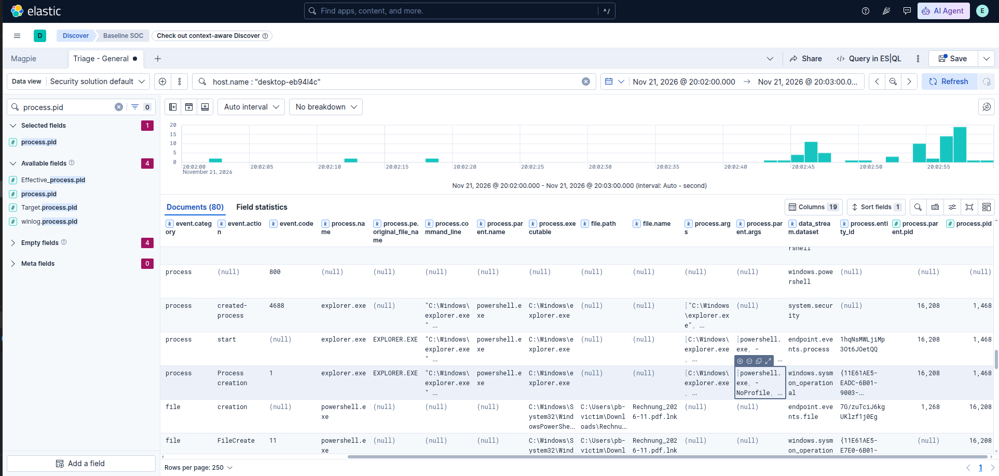

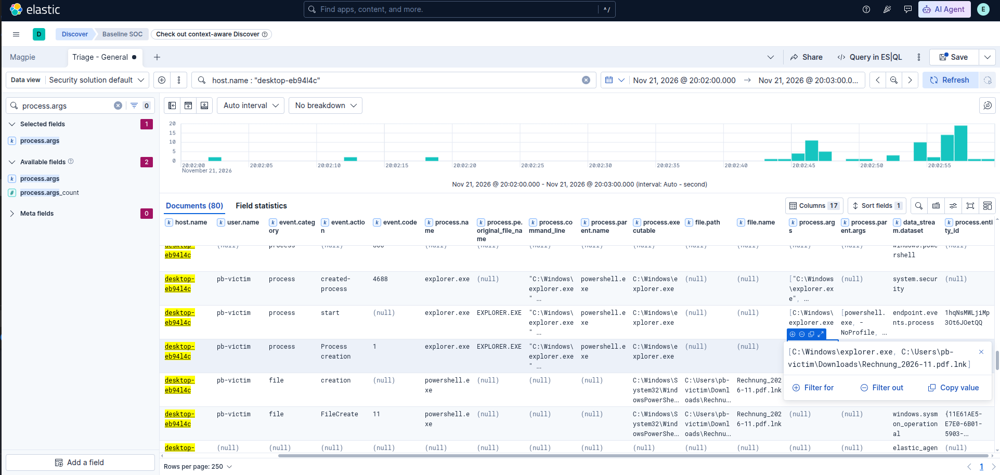

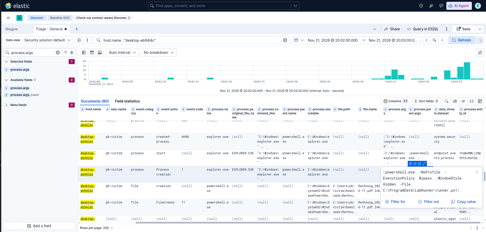

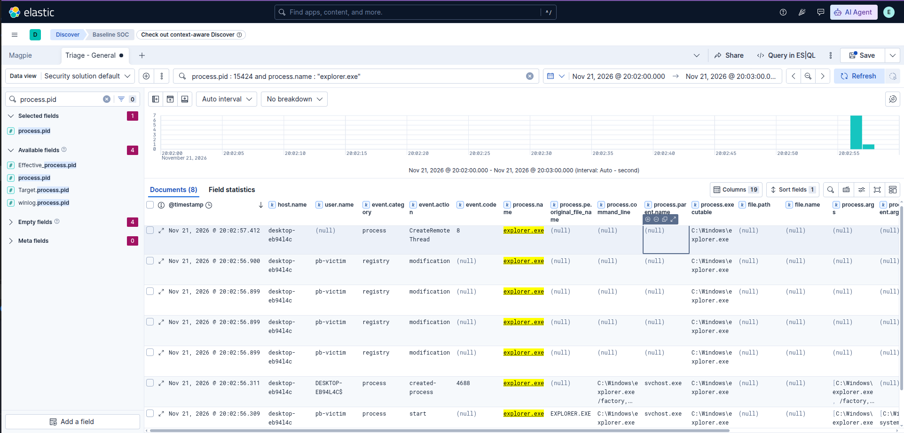

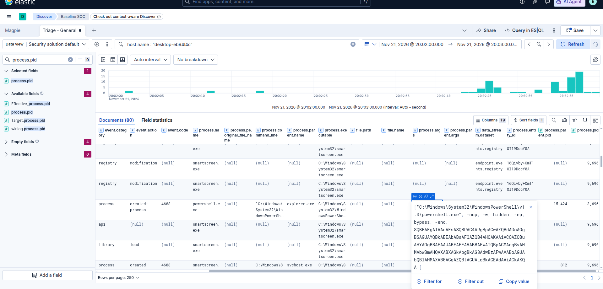

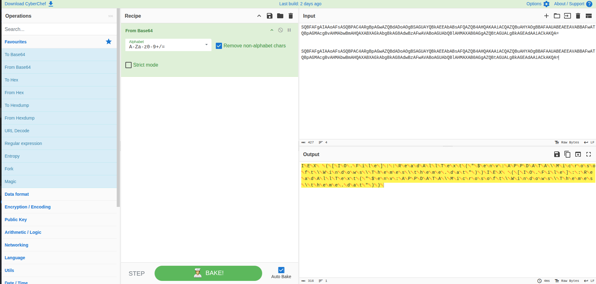

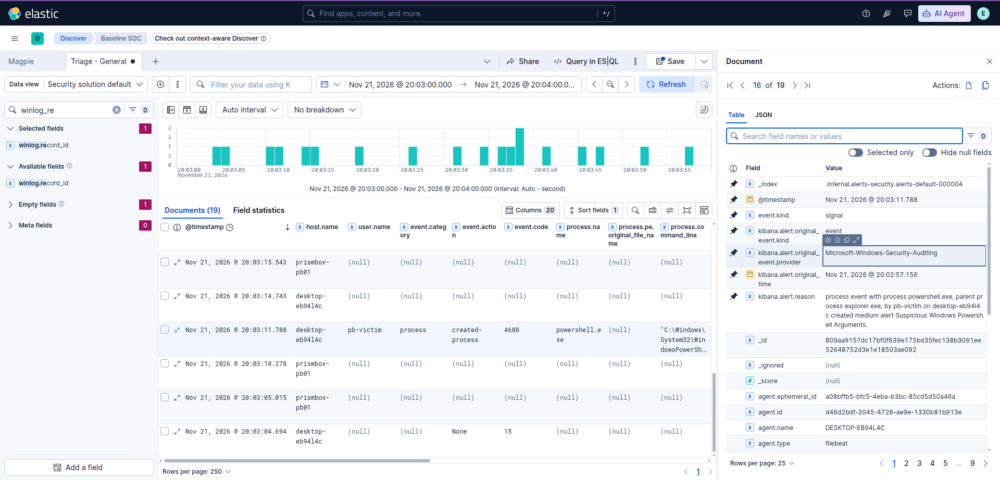

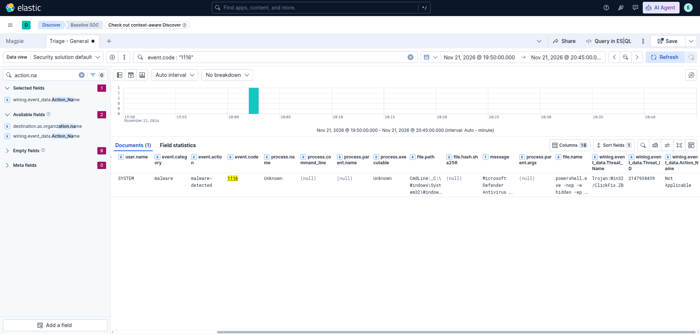

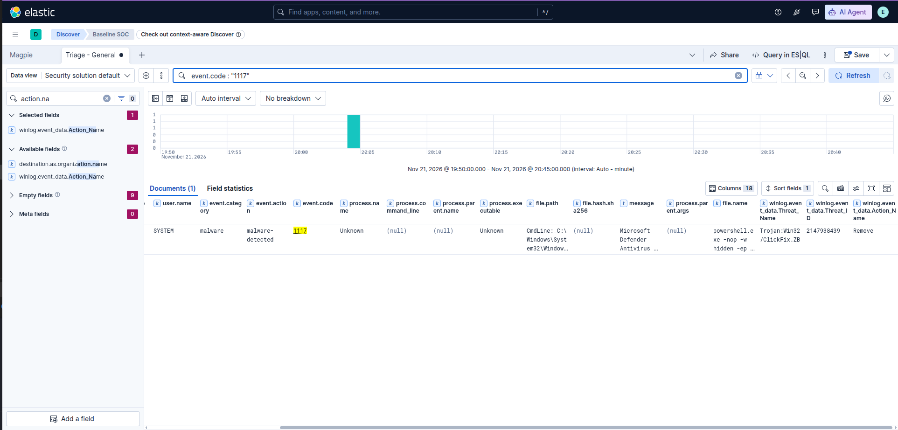

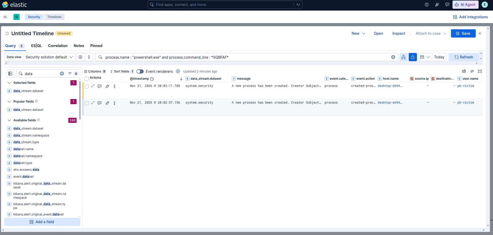

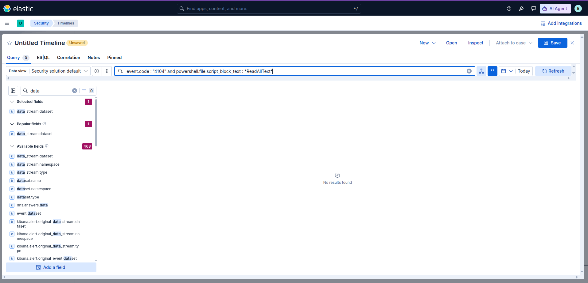

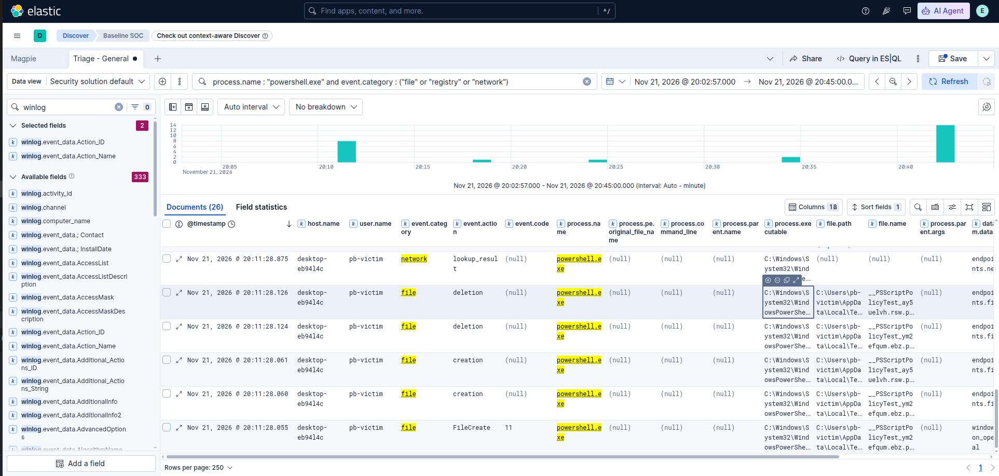

