## Alert 7: Suspicious Explorer Child Process
- **Alerttime:** 20:27:02.340
- **EventTime / host / user:** 20:24:57.049 / desktop-eb94l4c / pb-victim
- **Severity / risk score:** Medium / 47
- **What fired:** cmd.exe with parent explorer.exe /factory, {75dff2b7...} -Embedding,  this CLSID is not on the rule's exclusion list
- **Process tree:** parent: explorer.exe with pid 22584 -> child: cmd.exe with pid 28268 -> schtask.exe with pid 5680 (scheduled task created)
- **What I checked:** filename : Dokumente Backup woechentlich, file.name : \*Backup\* or file.path : \*Dokumente_Backup\*, process.name : "7z.exe", process.code_signature, fields: process.args; process.parent.args; process.pid; process.parent.pid; data_stream.dataset; process.name; process.parent.name; process.pe.original_file_name; process.command_line, process.executable, winlog.event_data.TaskContent (event 4698); pid correlation with alerts 9 & 10 (process.pid 5680 / 28268)
- **Benign hypothesis:** what would make this harmless? Evidence for/against:
  - Evidence for: the executed task and command line are often used by IT support/administrator + the TaskContent settings (hidden false, Least Privilege, interactive only, weekly, battery settings, readable author/name) and the action writes a local archive to the Desktop
  - Evidence against: scheduled task + archive of Documents can be a risk like a persistence/staging pattern, 7z.exe is unsigned, with hash not checked and the launch method stays unproven
- **Verdict:** benign-TP · confidence 85 %
- **Reasoning:** the task created is a backup which is running each week on sunday at 18:00 and this is a normal process to perform in IT/cybersecurity. furthermore the zip file appears only at the creation ( no later event after the creation) and the task hasn't run yet.
- **Limitations:** the task never ran during the run (scheduled on Sunday at 18:00), the reads of the zip file are not logged and the launch of the cmd.exe is unproven (no .lnk)
- **Context:** there was a manual backup at 20:18 (powershell.exe with pid 16208 wrote Backup Dokumente.lnk to the Desktop at 20:18:23.975, (runner) -> 7z.exe with pid 25936, opened Passwords.kdbx, which is part of Documents\* -r, and created Dokumente_Backup_2026-11.zip).
- **Follow up / tuning idea:** Alert 7 = Sysmon (windows.sysmon_operational), alert 8 = its duplicate from Elastic Defend (endpoint.events.process), alerts 9 and 10 belong to the same schtasks (pid 5680); this is the 3rd hit for T2 (CLSID) and T3 (duplicate pair)

---

## Hunt (15 min)
| Query | What I looked for | Finding |
|---|---|---|

## Summary
| # | Alert | Verdict | Confidence |
|---|---|---|---|
|007|Suspicious Explorer child Process|benign-TP|85%|

## Evidence

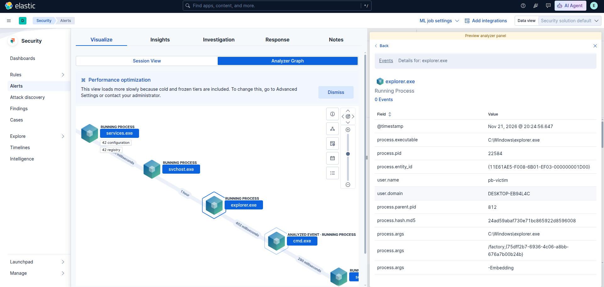

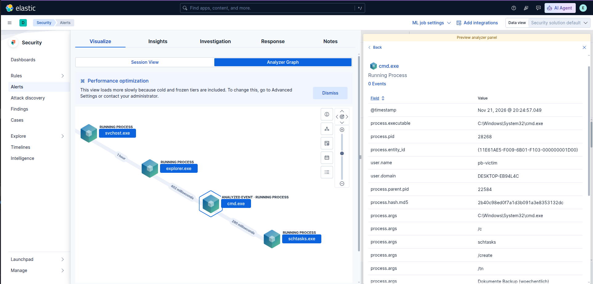

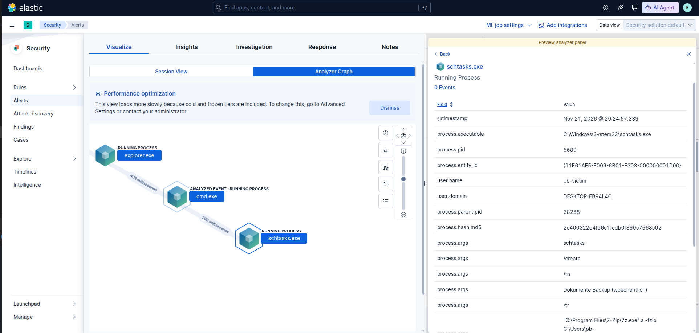

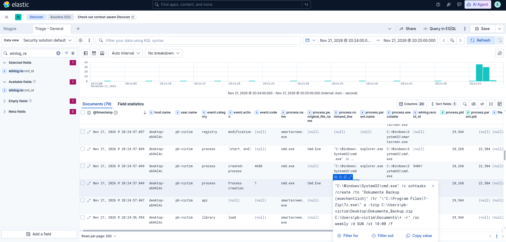

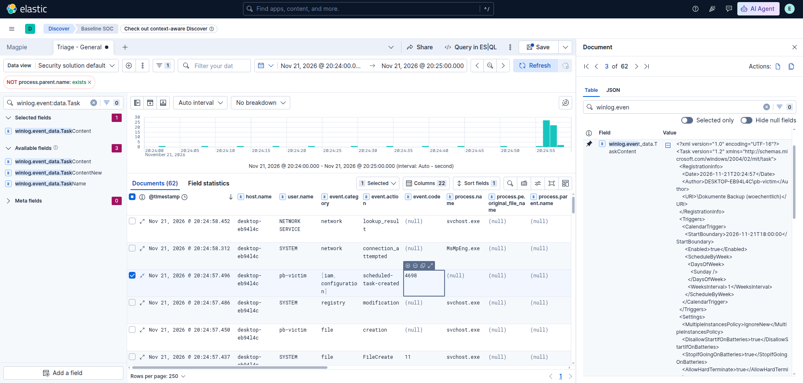

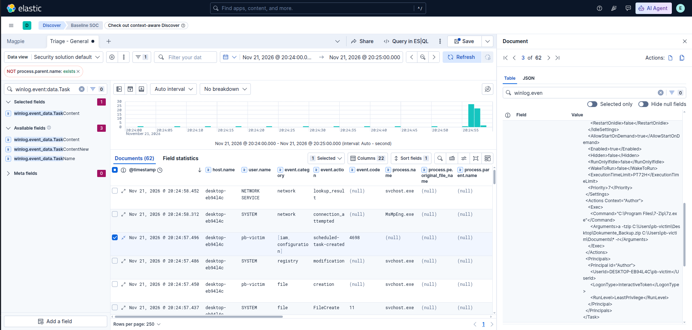

Full task XML (text): [taskcontent-4698.xml](taskcontent-4698.xml)

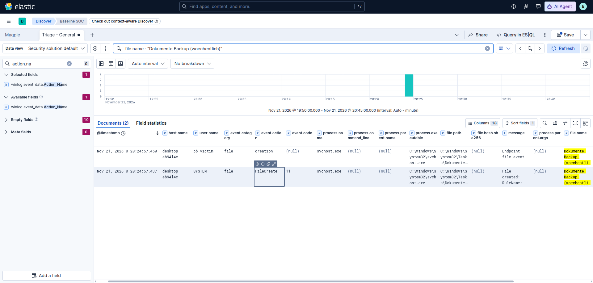

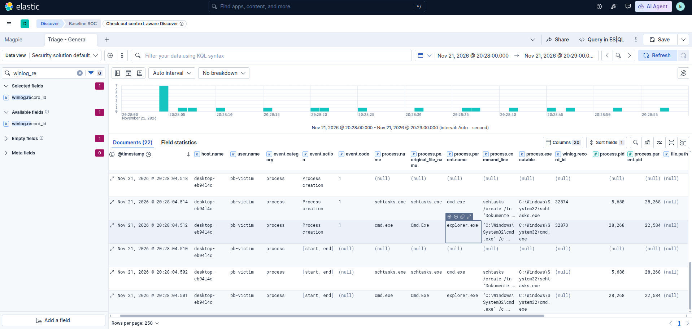

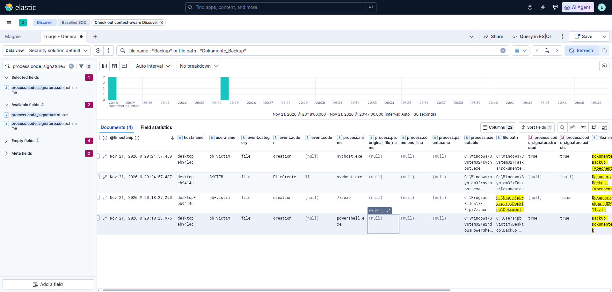

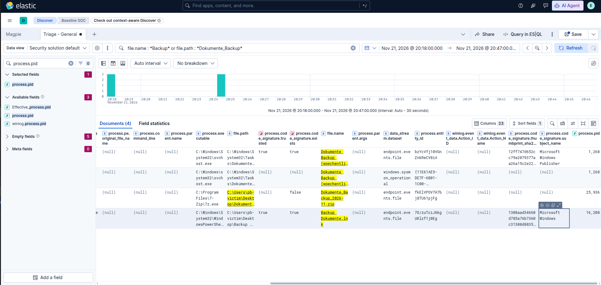

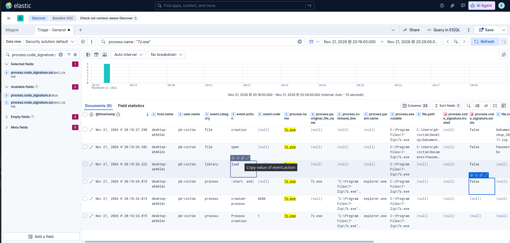

