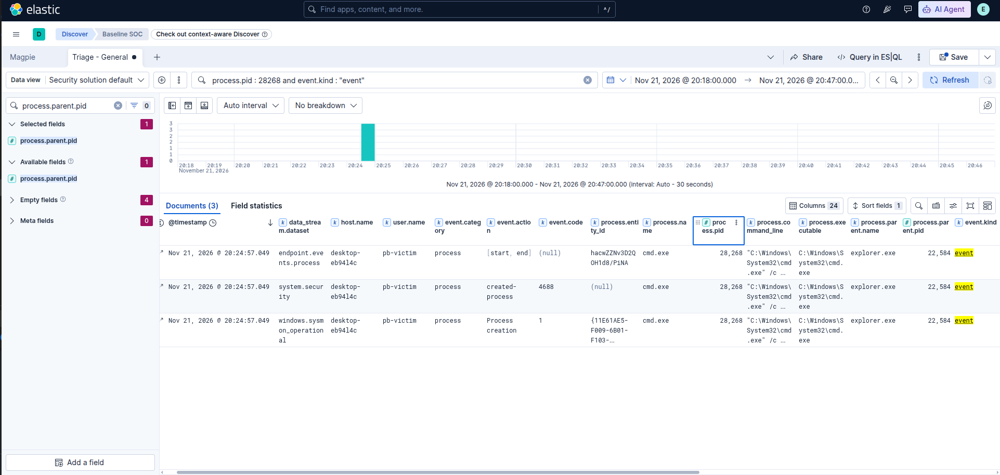

## Alert 8: Suspicious Explorer Child Process
- **Alerttime:** 20:27:02.343
- **Time / host / user:** 20:24:57.049 / desktop-eb94l4c / pb-victim
- **Severity / risk score:** Medium / 47
- **What fired:** cmd.exe with parent explorer.exe /factory, {75dff2b7...} -Embedding, this CLSID is not on the rule's exclusion list
- **Process tree:** explorer 22584 -> cmd 28268 -> schtasks 5680
- **What I checked:** the comparison query (process.pid : 28268 and event.kind : "event") and the fields data_stream.dataset, process.pid, process.parent.pid, process.entity_id
- **Duplicate Evidence:** same timestamp, same pid/parent pid; different dataset (alert 8 = Defend, alert 7 = Sysmon) and therefore different entity_id.

  | Dataset | event.code | process.entity_id | pid | parent pid |
  |---|---|---|---|---|
  | endpoint.events.process (Defend) → alert 8 | – | hacwZZNv3D2QOH1d8/PiNA | 28268 | 22584 |
  | windows.sysmon_operational (Sysmon) → alert 7 | 1 | {11E61AE5-F009-6B01-F103-…} | 28268 | 22584 |
  | system.security (4688) → no alert | 4688 | (null) | 28268 | 22584 |

- **Verdict:** Duplicate to Alert 7 / benign-TP · confidence 85%
- **Reasoning:** No separate reasoning. Refer to alert 7
- **Follow-up / tuning idea:** 3rd duplicate pair (T3); 4688 recorded the same process but could not alert (no process.parent.args, no entity_id)

---

## Summary
| # | Alert | Verdict | Confidence |
|---|---|---|---|
|008|Suspicious Explorer Child Process|Duplicate of 007 / benign-TP|85%|

## Evidence

