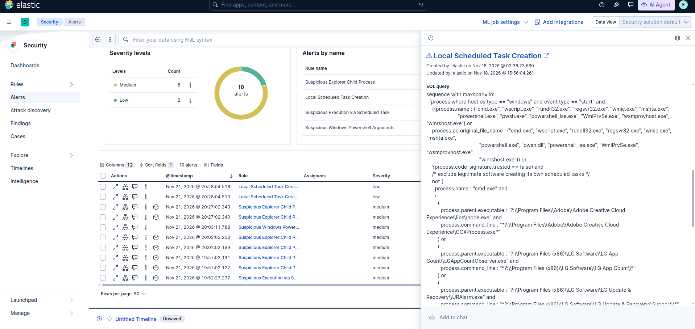
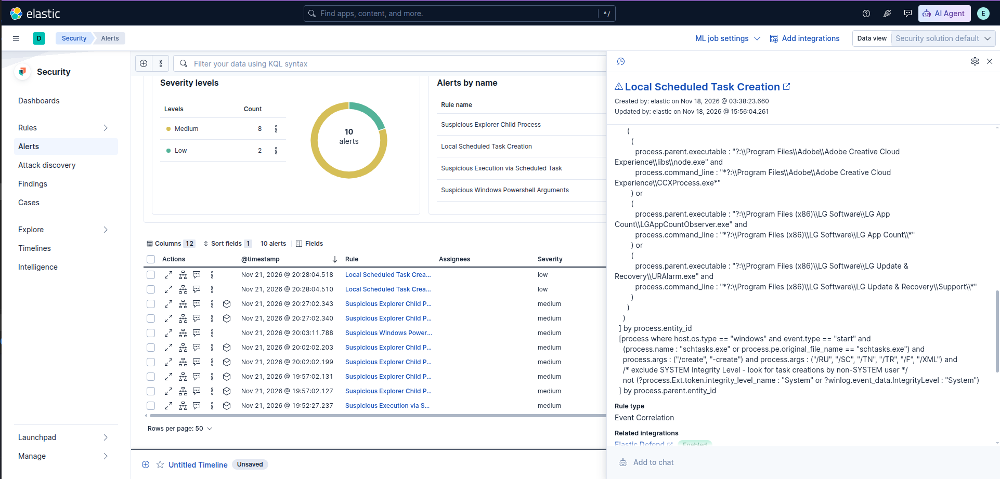
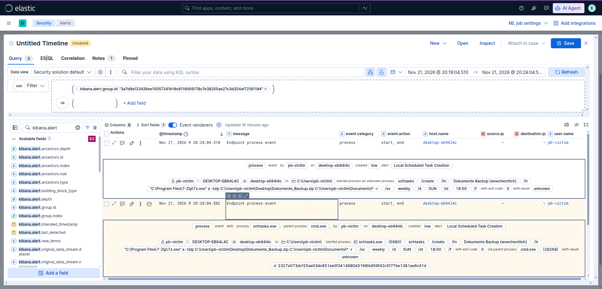
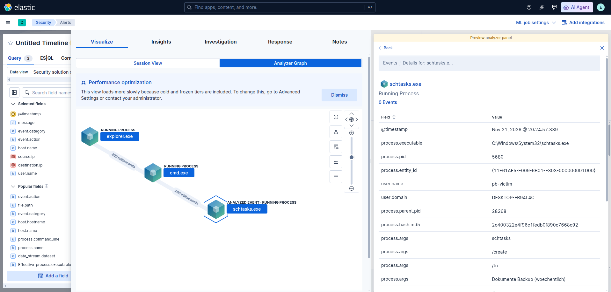
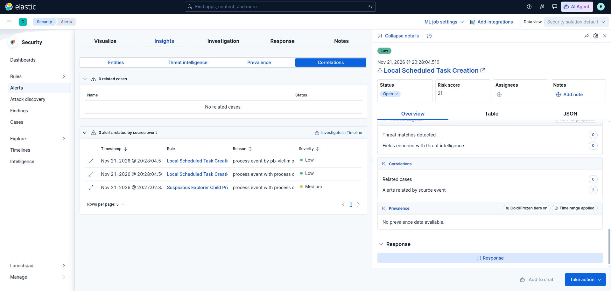

## Alert 9: Local Scheduled Task Creation
- **Alerttime:** 20:28:04.510
- **Time / host / user:** 20:24:57.339 / desktop-eb94l4c / pb-victim
- **Severity / risk score:** Low / 21
- **What fired:** The match cmd.exe’s entity_id = schtasks.exe’s parent.entity_id, within 1 minute with conditions /create (mandatory) plus /tn /tr /sc /f (args present in the command line), not as SYSTEM
- **Process tree:** parent: explorer.exe with pid 22584 -> child: cmd.exe with pid 28268 -> schtasks.exe with pid 5680
- **What I checked:** query data_stream.dataset; the rule type Event Correlation; the EQL sequence to understand why the rule triggered (args condition, SYSTEM exclusion, the entity_id join); shell alert vs member events, linked through kibana.alert.group.id; the pid / entity link with cmd.exe with pid 28268 (entity_id) as parent of schtasks.exe with pid 5680 - this is exactly the same chain as in alert 7; Analyzer on schtasks.exe for the args (/create, /tn, /tr, /sc); Insights where 3 alerts come from the same source event; duplicate check (Defend vs Sysmon) for alerts 9 & 10
- **Benign hypothesis:** The hypothesis comes from alert 7, no new content. Specific to this rule: the task was created by pb-victim (not SYSTEM) from an interactive cmd.exe, which is exactly what the rule looks for; alert 7 explains why this task is harmless here.
- **Verdict:** benign-TP · confidence 85%
- **Reasoning:** Task content analyzed in alert 7, no new reasoning, refer to alert 7
- **Limitation:** the task never ran during the run (scheduled on Sunday at 18:00), the reads of the zip file are not logged and the launch of the cmd.exe is unproven (no .lnk), same limitations as in alert 7
- **Follow-up / tuning idea:**
  - Alert 9 = Elastic Defend (endpoint.events.process), alert 10 = its Sysmon duplicate (windows.sysmon_operational)
  - Fourth duplicate pair (T3)
  - 4688 is blind here too: the rule needs entity_id which 4688 does not have
  - Rule tuning: one user action produced 4 alerts (alerts 7, 8, 9, 10) across 2 rules and 2 sensors.

---

## Summary
| # | Alert | Verdict | Confidence |
|---|---|---|---|
|009|Local Scheduled Task Creation|benign-TP|85%|

## Evidence

