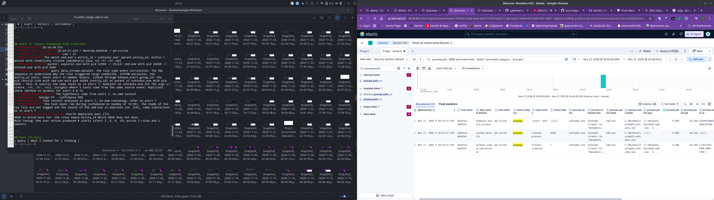

## Alert 10: Local Scheduled Task Creation
- **Alerttime:** 20:28:04.518
- **Time / host / user:** 20:24:57.339 / desktop-eb94l4c / pb-victim
- **Severity / risk score:** Low / 21
- **What fired:** same rule as alert 9
- **Process tree:** same as alert 9
- **What I checked:** queries: process.pid : 5680 and event.kind : "event" and event.category : "process"; fields: data_stream.dataset, timestamp, process.entity_id
- **Benign hypothesis:** same as alerts 7, 8 and 9
- **Duplicate Evidence:** same timestamp, same pid/parent pid but different dataset (Alert 10 = Sysmon and Alert 9 = Elastic Defend) so different process.entity_id

  | Dataset | event.code | process.entity_id | pid | parent pid |
  |---|---|---|---|---|
  | endpoint.events.process (Defend) → alert 9 | – | a7QtMrEKNe6ibNxjKIUGw | 5680 | 28268 |
  | system.security (4688) → no alert | 4688 | (null) | 5680 | 28268 |
  | windows.sysmon_operational (Sysmon) → alert 10 | 1 | {11E61AE5-F009-6B01-F303-…} | 5680 | 28268 |

- **Verdict:** same as alert 9 - benign-TP · confidence 85%
- **Reasoning:** same as alert 9
- **Follow-up / tuning idea:** Fourth duplicate pair (T3); 4688 can't alert since it has no process.entity_id

---

## Summary
| # | Alert | Verdict | Confidence |
|---|---|---|---|
|010|Local Scheduled Task Creation|benign-TP|85%|

## Evidence

