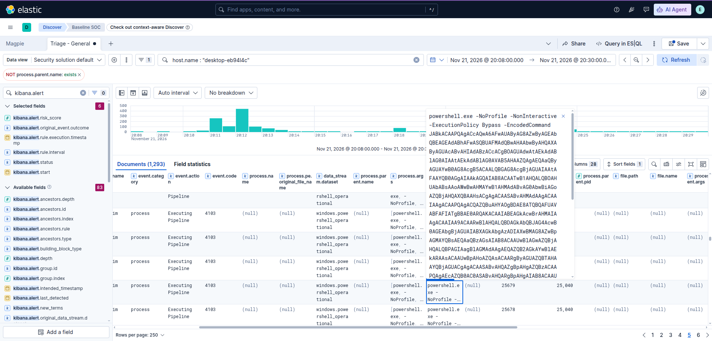
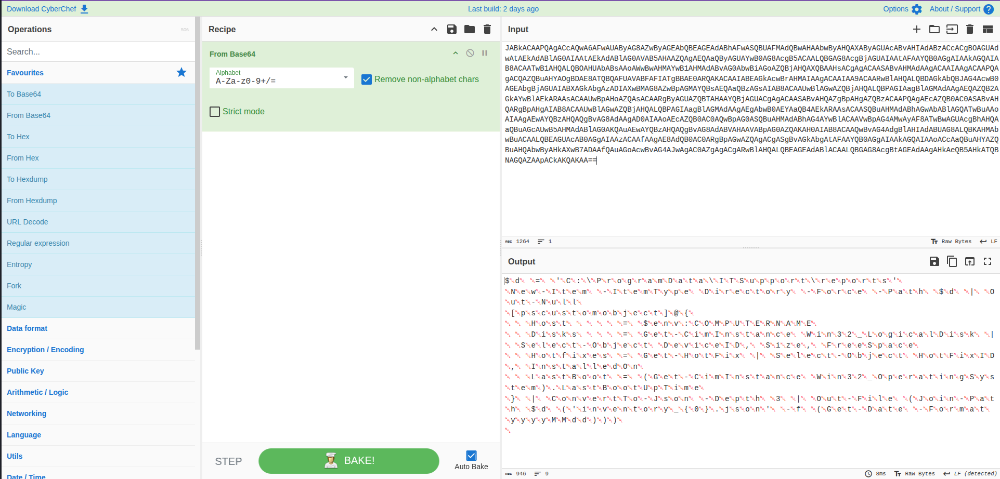
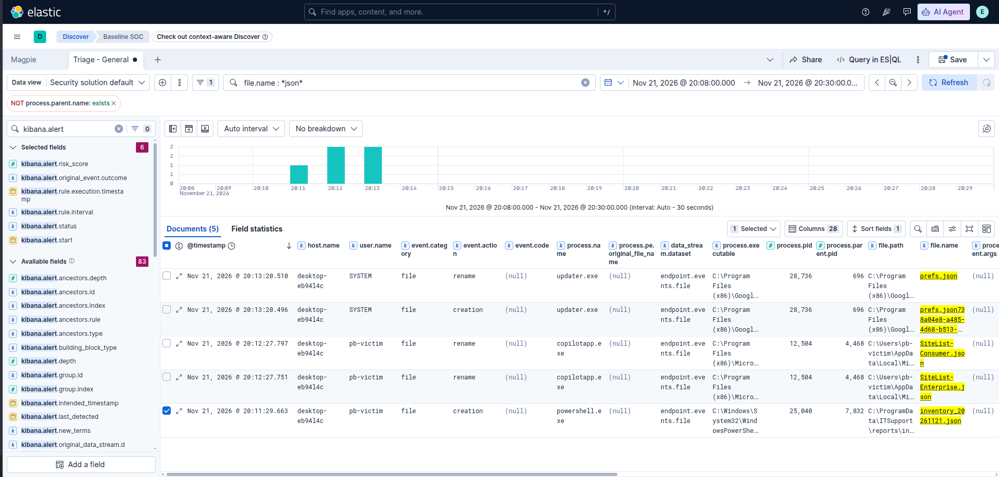
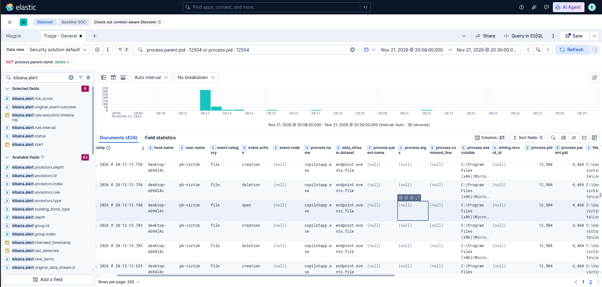
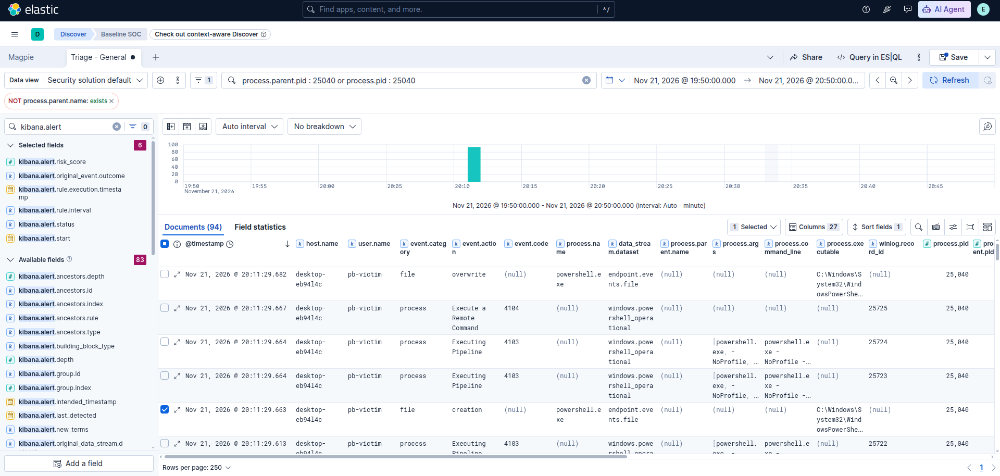
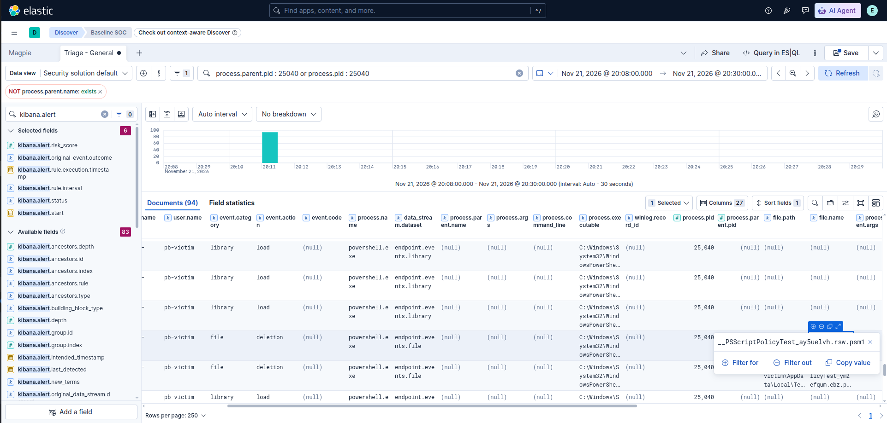

# Hunt 01: Encoded PowerShell without alert

## Hunt (timebox: ~20 min)
| Query | What I looked for | Finding |
|---|---|---|
|host.name : "desktop-eb94l4c" 20:08-20:30 -> encoded Powershell; file.name : \*json\*; process.pid : 25040|A encoded Powershell without an alert, and what it produced|pid 25040, -NoProfile -NonInteractive -ExecutionPolicy Bypass -EncodedCommand; decode = endpoint inventory (computer name, disks, hotfixes, last boot) -> C:\ProgramData\ITSupport\reports\inventory_20261121.json; no network seen; parent pid 7832 not investigated (timebox); pid 12504 (copilotapp) and updater.exe unrelated (no linking field)|

## Verdict

With those informations collected I could not do a verdict. Within the timebox (20min) I did not have the time to collect more information and context like the process parent pid 7832, the launch method and any future user of the JSON file found.

## Evidence

