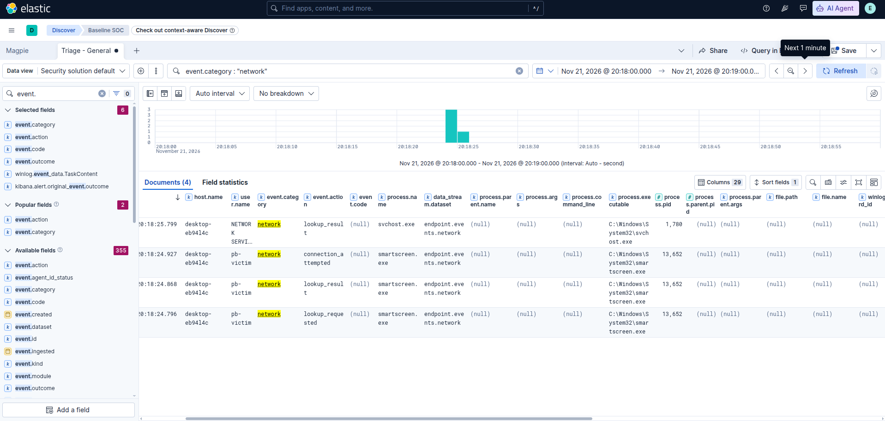
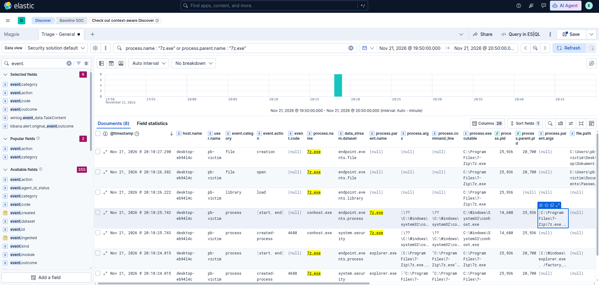
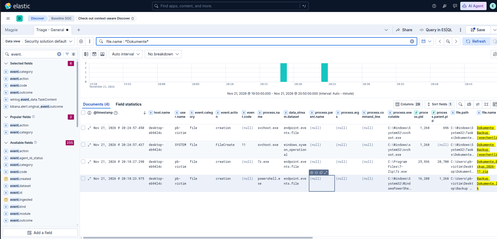
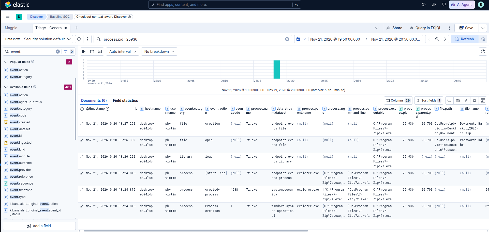

# Hunt 02: Manual 7z backup without alert

## Hunt (timebox: ~15 min)
| Query | What I looked for | Finding |
|---|---|---|
|process.name : "7z.exe" or process.parent.name : "7z.exe" (19:50-20:50); process.pid : 25936; file.name : \*Dokumente\*; event.category : "network" (20:18-20:19)|The manual 7z backup at 20:18 without an alert: collection/staging of documents for document exfiltration? Link to the scheduled task at 20:24?|**Launch:** 7z.exe pid 25936, parent explorer.exe pid 20700 (/factory, shortcut handoff), 20:18:24.815, seen by Defend, 4688 and Sysmon **Delivery:** Backup Dokumente.lnk created 20:18:23.975 by pid 16208 (runner = lab stand-in) **Activity:** opened Passwords.kdbx as part of Documents\\\* -r → created Desktop\Dokumente_Backup_2026-11.zip (20:18:27.290); child conhost.exe pid 14680 (normal console host) **Network 20:18–20:19:** only svchost (NETWORK SERVICE) and smartscreen.exe; no connection from 7z.exe; no further use of the zip found **Relation to the 20:24 task:** no linking field (different process svchost pid 1268, different zip name) → thematic only **Why no alert:** expected; Explorer Child rule covers script interpreters only, 7z.exe not in the list|

## Verdict
In possession of all the informations and evidences I collected, I think this path shows no threat. There were no exfil of files attempted or any abuse found from the zip file or other files, my confidence about it is 80%.

**Benign - 80% confidence**

## Evidence

