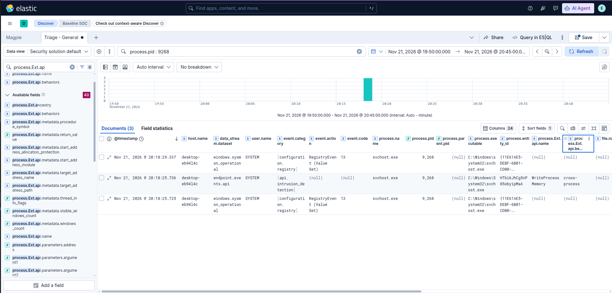
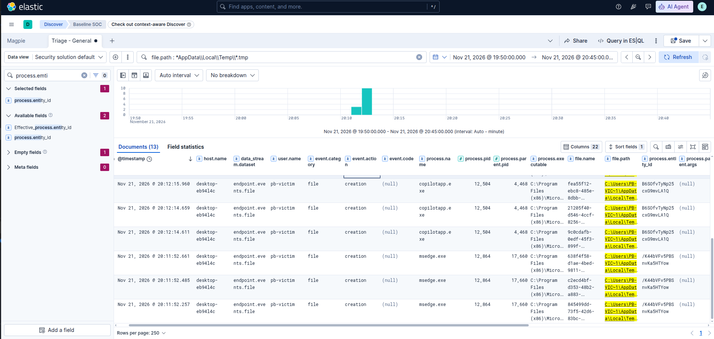
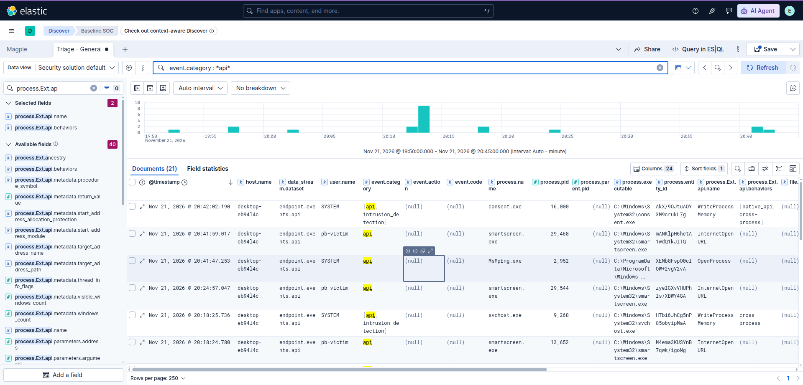
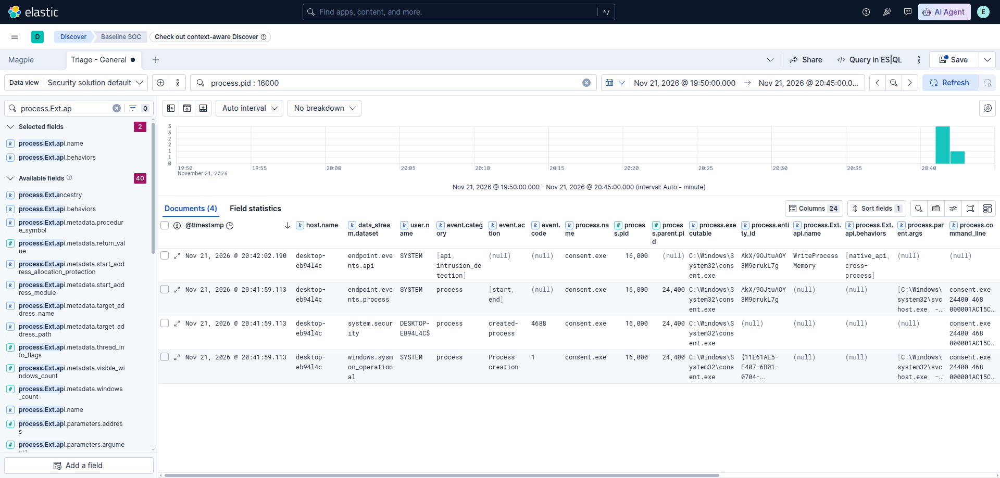
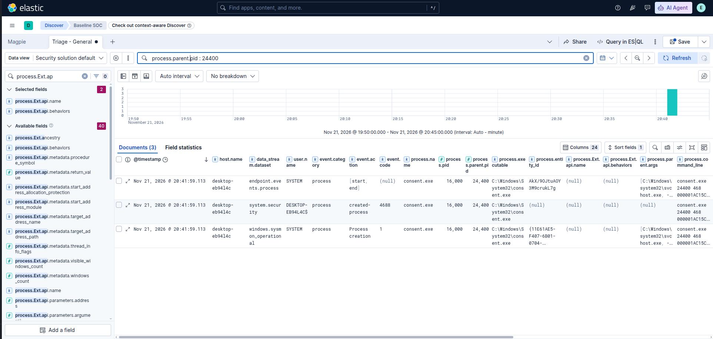

# Hunt 03: API events on system processes and .tmp files

## Hunt (timebox: ~15 min)
| Query | What I looked for | Finding |
|---|---|---|
|event.category : \*api\* (19:50-20:45); process.pid : 9268; process.pid : 16000 / process.parent.pid : 24400; file.path : \*AppData\\\\Local\\\\Temp\\\\\*.tmp; no query, time range 20:18:00–20:19:00 (overview of everything in that minute) **Fields used:** process.Ext.api.name, process.Ext.api.behaviors, event.category, event.action, event.code, process.name, process.pid, process.parent.pid, process.parent.args, user.name, file.path, file.name, data_stream.dataset|The API / intrusion_detection event on svchost (SYSTEM) at 20:18:25 and the .tmp files in AppData\Local\Temp: is something hiding in system processes or temp files, unnoticed by the rules?|I did not find anything concrete nor I could define the context. I did not have the necessary knowledge to rule out or to connect the dots between the lines. consent.exe (UAC) at 20:41:59 = my own elevated PowerShell to check DONE → excluded.|

## Verdict
I cannot say if this is benign nor malicious, I did not define the context to meet a decision. So no verdict on this hunt 03.

**No verdict (inconclusive)**

## Evidence

